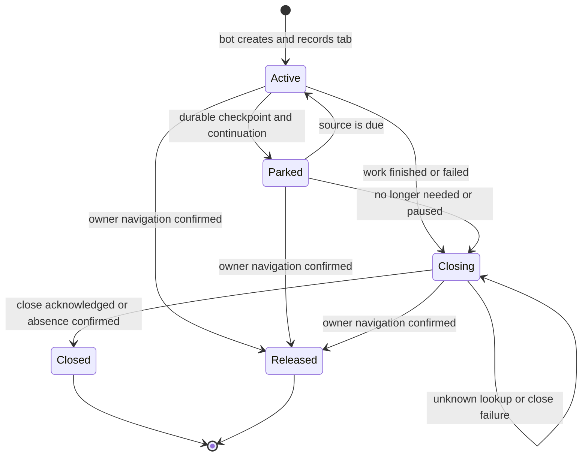

# ออกแบบการปิดแท็บบอทหลังใช้งาน

สถานะ: นำแบบนี้ไปใช้ใน runtime รุ่น **1.11.15** แล้ว ดูผลหลังแก้ท้ายเอกสาร ส่วนการวิเคราะห์ด้านล่างเป็น baseline ก่อนแก้เมื่อ 9 พฤศจิกายน 2026 ยังไม่ได้ตรวจหรือปิดแท็บจริงบนเครื่องของเจ้าของ

เป้าหมาย: เมื่อจบงานให้ปิดเฉพาะแท็บที่บอทสร้างและหมดหน้าที่ พร้อมเก็บข้อมูลที่ต้องอ่าน/รายงานต่อไว้ โดยไม่ปิดแท็บส่วนตัวหรือส่งคอมเมนต์ซ้ำ

## สาเหตุที่ยืนยันได้

### 1. อ่านเนื้อหาเต็มแล้วลืมแท็บโดยไม่ได้ปิด

เส้นทางจริงใน `extension/background.js`:

1. `processFullTextQueue` เรียก `openReader("about:blank")`
2. `openReader` เก็บ `reader.url` และ `session.readers[tabId].url` เป็น `about:blank`
3. `readFullTexts` สั่ง `chrome.tabs.update(tabId, { url })` ไปหน้าโพสต์ แต่ไม่เปลี่ยน URL ที่ ownership คาดไว้
4. `finally` เรียก `closeReader` → `releaseReaderTab`
5. `releaseReaderTab` พบ URL จริงไม่ตรง `about:blank` จึงเข้าเงื่อนไขที่ตั้งใจป้องกันการปิดแท็บที่เจ้าของนำไปใช้ต่อ และคืน `true` โดยไม่เรียก `tabs.remove`
6. `closeReader` ลบ ownership ออก และอาจปิดแท็บว่างหลัก เหลือหน้าโพสต์ที่ไม่มีใครติดตามให้เก็บกวาดอีก

นี่เป็นบั๊ก ไม่ใช่การตั้งใจเก็บ cursor เพื่ออ่านต่อ เกิดจากการใช้เงื่อนไข “เปลี่ยนหน้าแล้ว” แทน “เจ้าของเปลี่ยนหน้าเอง” ทั้งที่บอทเป็นผู้สั่งเปลี่ยนหน้า

ตัวจำลองเรียก `releaseReaderTab` จากไฟล์จริง ได้ผลแน่นอน:

| กรณี | เรียกปิดแท็บ | อนุญาตให้ลบ ownership |
| --- | --- | --- |
| Reader ปกติ URL ตรง | 1 ครั้ง | ใช่ |
| บอทเปลี่ยนจาก about:blank ไปหน้าโพสต์ | 0 ครั้ง | ใช่ — ผิด |
| เจ้าของเปลี่ยนไปหน้าส่วนตัว | 0 ครั้ง | ใช่ — ถูกต้อง |

กรณีควบคุมยืนยันว่าเส้นทางปิดปกติทำงาน และเงื่อนไขป้องกันแท็บส่วนตัวจำเป็นต้องคงไว้ ไม่ควรแก้ด้วยการลบการตรวจ URL ทั้งหมด

### 2. Chrome อ่านข้อมูลแท็บไม่สำเร็จถูกตีความว่าแท็บหายไป

`releaseReaderTab`, `closeIdleScrapeWindow` และ `ownedCommentTab` ใช้ `tabs.get(...).catch(() => null)` จึงแยกไม่ได้ระหว่างแท็บถูกปิดจริงกับ Chrome API ผิดพลาดชั่วคราว ในเส้นทาง reader/comment จึงลบ ownership ได้ทั้งที่ไม่ได้ปิดแท็บ

ตัวจำลองให้ `tabs.get` โยน temporary error ขณะที่แท็บยังมีอยู่:

- Reader: ไม่เรียก `tabs.remove` แต่คืนสถานะให้ caller ลบ ownership
- Comment recovery: ไม่เรียก `tabs.remove` และล้าง `session.commentTab`

การเก็บ ownership เมื่อ `tabs.remove` ล้มเหลวที่มีอยู่เดิมจึงยังครอบคลุมไม่ถึงข้อผิดพลาดตอน **อ่านข้อมูลแท็บก่อนปิด**

### 3. บางแท็บยังมีงาน และบางแท็บไม่มีหลักฐานความเป็นเจ้าของแล้ว

- `scrapeGroupPass` ตั้ง `retain` เมื่อหมดเวลาย่อย/โหลดไม่คืบหน้า จึงไม่ปิด reader ที่มี continuation: เป็นพฤติกรรมตามการออกแบบเพื่อรักษาตำแหน่งอ่าน
- `closeOrphanReaders` อาจเก็บ continuation ที่ตรงเซิร์ฟเวอร์/บัญชีและ checkpoint ยังอายุไม่ถึง 2 ชั่วโมง; อายุถูกนับจาก checkpoint ล่าสุด ไม่ใช่เวลาเปิด Chrome ทั้งหมด
- จำกัด parked feeds เดิมไม่เกิน 20 รายการ ส่วน active readers ไม่เกิน 2 รายการ จึงเห็นแท็บมากกว่า 2 ได้แม้มีงานทำพร้อมกันเพียง 2 กลุ่ม
- หลัง Reload extension หรือปิด Chrome ทั้งโปรแกรม ไม่ควรใช้ `storage.session` เดิมเป็นหลักฐาน ownership และไม่ควรเดาจาก URL Facebook อย่างเดียว แท็บที่หลุด metadata จากข้อ 1–2 ก็ไม่ควรถูกกวาดย้อนหลังแบบเหมารวม

ยังระบุไม่ได้ว่าแท็บทุกใบที่เจ้าของเห็นอยู่ในกรณีใด เพราะ heartbeat ปัจจุบันไม่ส่งสถานะ ownership/เหตุผลการคงแท็บเป็นรายประเภท และ `tabsJson` รวมแท็บ Facebook ที่เจ้าของเปิดเองด้วย

## แบบที่แนะนำ

เริ่มจากแก้กลไกเดิม ไม่จำเป็นต้องสร้าง scheduler หรือ tab manager ใหม่ทั้งระบบ การปิดหลังจบงานต้องเป็นค่าเริ่มต้น ไม่มีสวิตช์ใหม่ที่เจ้าของต้องมาเปิด

### กติกาต่อประเภทแท็บ

| ประเภท/สถานะ | การจัดการที่ต้องได้ |
| --- | --- |
| อ่านกลุ่มจบจริง: seen/old/exhausted | จบงานแล้วเข้าขั้นปิดทันที ไม่รอ heartbeat |
| อ่านเนื้อหาเต็มเสร็จหรือ timeout | เก็บข้อมูลลง outbox/recovery ก่อน แล้วปิดแท็บ ไม่ต้องค้างรอเครือข่ายกลับมา |
| คอมเมนต์จบ/ล้มเหลว/ผลไม่ชัดเจน | เก็บ journal/pending report ก่อน แล้วปิดแท็บ; การรายงานต่อไม่ต้องเก็บหน้า Facebook ไว้และห้ามเรียกส่งซ้ำ |
| กำลังอ่านหรือกำลังส่ง | คงแท็บไว้ ห้าม cleanup ตัดงาน |
| รออ่านต่อและยังมีความคืบหน้า | คง cursor ตามรอบ 30/60 วินาทีและคิวกลุ่มเดิม; ใช้ cap 20 เดิม ไม่ปิดทุก slice แล้วเริ่มไล่จากหัวฟีดใหม่ |
| รออ่านต่อแต่ไม่คืบหน้าซ้ำ | ในระยะถัดไปเสนอให้คืน DOM หลัง 3 slices ติดต่อกันที่ไม่พบโพสต์ใหม่ และทำ reload/recovery ตามกลไกเดิมแล้ว เก็บ durable recovery และจัดคิวกลุ่มเดิมต่อ; ต้องทดสอบ deep catchup ก่อนเปิดใช้ ไม่เปลี่ยนพร้อม hotfix |
| บัญชี/การเก็บถูกพัก หรือแหล่งข้อมูลถูกปิด | ปิดเฉพาะแท็บที่ไม่ active ในรอบ cleanup โดยคง pending/checkpoints ตามเดิม |
| เจ้าของนำแท็บไปหน้าอื่น | ถอน ownership และคงแท็บนั้นไว้ |
| อ่านข้อมูลแท็บไม่ได้/Chrome ปฏิเสธปิด | คง ownership ไว้เป็น `closing` แล้วลองใหม่ ไม่สรุปว่าปิดแล้ว |
| แท็บว่างหลัก | ปิดเฉพาะ ID ที่บอทสร้าง เมื่อไม่มี reader ต้องใช้ ไม่ปิดทั้งหน้าต่างที่มีแท็บส่วนตัว |
| ไม่มีหลักฐาน ownership | ไม่ปิดอัตโนมัติตาม URL ให้เจ้าของปิดเองครั้งแรก |

### ปรับความหมายผล cleanup ให้ชัด

ใช้ผลลัพธ์แยกแทน `true`/`null` ที่รวมหลายความหมาย:

| ผล | ความหมาย | ลบ ownership ได้หรือไม่ |
| --- | --- | --- |
| `closed` | Chrome ยอมรับการปิดแท็บ | ได้ |
| `gone` | ตรวจยืนยันว่าไม่มีแท็บ ID นั้นแล้ว | ได้ |
| `released` | อ่าน URL สำเร็จและยืนยันว่าไม่ใช่เป้าหมายที่บอทใช้อยู่ | ได้ แต่ห้ามปิดแท็บ |
| `retry` | อ่านข้อมูลไม่สำเร็จ/ปิดไม่ได้/รอเกินเวลา | ไม่ได้ |

ถ้า `tabs.get` ล้มเหลว ให้ลอง query รายการแท็บเพื่อตรวจ ID นั้น **เฉพาะในกรณี error** ถ้า query สำเร็จและไม่มี ID จึงเป็น `gone`; ถ้ายังพบ ID หรือ query ก็ล้มเหลว ให้เป็น `retry` การมี ID อย่างเดียวไม่ใช่สิทธิ์ให้ปิด ต้องตรวจ URL ตาม ownership ต่อด้วย

ใช้กติกาเดียวกันกับ reader, comment และ blank container ไม่กลืน error แล้วล้าง metadata หลีกเลี่ยงการจับข้อความ error ภาษาอังกฤษของ Chrome เป็นหลักฐานเดียว

### แก้ URL ownership ด้วยข้อมูลที่บอทรู้อยู่แล้ว

Hotfix ที่เล็กที่สุดสำหรับ full-text ซึ่งปัจจุบันอ่านทีละ URL:

1. เปิด reader ด้วย URL เป้าหมายที่รู้อยู่แล้ว แทน `about:blank`
2. ให้ `readFullTexts` รอ navigation ครั้งนั้นและอ่าน ไม่สั่งโหลด URL เดิมซ้ำอีกรอบ
3. เก็บ URL เป้าหมายและประเภทงานใน session ก่อนเริ่มอ่าน
4. ในทุกเส้นทาง `finally` ตรวจ ownership เดิมแล้วปิด; ถ้าปิดไม่ได้ให้เก็บไว้ retry

ถ้าอนาคตใช้แท็บเดียววนอ่านหลาย permalink ต้องมี helper เปลี่ยนหน้าแท็บบอทซึ่งบันทึก target ที่อนุญาตก่อนสั่ง navigation พร้อมรักษาต้นทาง/ปลายทางขณะเปลี่ยนหน้า ไม่ให้ caller เปลี่ยน `tab.url` อย่างเดียวแล้วข้อมูล ownership ล้าหลัง

การเทียบ URL ต้องรองรับเฉพาะ canonical aliases ของโพสต์/กลุ่มเดียวกันที่ตรวจได้ ห้ามขยายเป็น “อยู่บน facebook.com ก็ปิดได้” สำหรับหน้า login/checkpoint หรือ redirect ที่ไม่สามารถยืนยันเป้าหมายได้ ให้รายงานเหตุผลและปล่อยให้เจ้าของตรวจ ไม่กดข้ามข้อจำกัด

### วงจรชีวิตที่ต้องตรวจสอบย้อนหลังได้

ปิดปกติทันทีหลังงานจบ ส่วน retry เกิดตอน heartbeat/ก่อนเริ่มรอบใหม่ ไม่ต้องสั่งอ่านหรือส่งคอมเมนต์เดิมเพื่อพยายามปิดแท็บ ใช้ระยะลองใหม่แบบเว้น 30/60/120 วินาที แล้วไม่ถี่กว่า 5 นาทีเมื่อ Chrome ยังไม่ตอบ อย่าลบ ownership เพราะลองครบจำนวนครั้ง และให้รายการ `closing` กิน capacity ของ pool เดิมเพื่อไม่เปิดแท็บทับถมไม่จำกัด

Alarm เป็นเวลาที่เร็วที่สุดที่พยายามทำงาน ไม่ใช่คำรับรองว่าจะปิดตรงวินาทีเมื่อ Chrome/เครื่องหลับ และการตั้ง timeout ไม่ยกเลิกคำสั่งที่ Chrome รับไปแล้ว

### ให้เจ้าของรู้ว่าทำไมแท็บยังอยู่

เพิ่มสถานะรวมใน popup/ภาพรวม โดยไม่เปิดเผย token หรือเนื้อหาโพสต์:

- กำลังทำงาน: อ่าน 1 / คอมเมนต์ 0
- รออ่านต่อ: 3 — มีงานในคิว
- รอปิด: 1 — Chrome ไม่ตอบ กำลังลองใหม่
- คืนให้เจ้าของแล้ว: จำนวนสะสมในรอบล่าสุด

เหตุผลต้องมาจาก lifecycle ที่บอทบันทึก ไม่เดาจากจำนวนแท็บ Facebook ทั้งหมด ปุ่ม **ปิดแท็บบอทที่เลิกใช้** เรียก cleanup เดียวกับอัตโนมัติ ไม่ปิด active readers, continuation ที่ยังจำเป็น หรือแท็บที่ไม่มี ownership

## ลำดับลงมือ

1. Hotfix URL ownership ของ full-text และผล lookup/close แบบแยกสถานะ พร้อม regression ที่ใช้ open → navigate → close จริงทั้งเส้นทาง
2. ให้ heartbeat เก็บเหตุผล `active/parked/closing/released` และตรวจ retry หลัง MV3 restart โดยยังใช้ session ownership เดิม
3. เพิ่มสถานะใน popup/ภาพรวม แล้วประเมินการคืน reader ที่ stalled หลาย slices ด้วยข้อมูลจริง ก่อนเปลี่ยนนโยบายเก็บ cursor

ยังไม่เสนอ persistent ownership ข้าม full Chrome restart เพราะ tab ID เดิมอย่างเดียวไม่ใช่หลักฐานปลอดภัย และไม่ควรเพิ่ม Chrome permission ใหม่โดยเงียบ ๆ เพื่อแก้การปิดแท็บ

## เกณฑ์ทดสอบก่อนใช้งาน

- Full-text สำเร็จ, หาเนื้อหาไม่เจอ, navigation timeout, outbox เต็ม และเครือข่ายหลุด: แท็บที่บอทสร้างถูกปิดหรือยังมี `closing`; pending/recovery ไม่หาย
- `tabs.get` temporary error แล้วหาย: ownership ยังอยู่ในรอบแรกและปิดได้ในรอบถัดไป ทั้ง reader/comment/container
- แท็บถูกเจ้าของปิดแล้ว: ยืนยัน `gone` แล้วจึงลบ ownership ไม่ retry ตลอดไป
- เจ้าของเปลี่ยนหน้า/ย้ายแท็บ/นำแท็บส่วนตัวเข้าหน้าต่างบอท: คงแท็บส่วนตัว ไม่ปิดทั้งหน้าต่าง
- Parked cursor ยังมีงาน: ไม่ถูก cleanup ทุกครั้งที่จบ slice; active readers ไม่ถูกปิด
- MV3 restart: กู้เฉพาะ ownership ใน session; full Chrome restart/Reload ที่ไม่มี metadata ไม่กวาดแท็บจาก URL
- Comment journal offline/uncertain: ปิดแท็บได้โดยไม่ลบรายงานค้าง และไม่มีการส่งซ้ำ
- Alarm และ cleanup พร้อมกับการเริ่มงาน: ใช้ lock เดิม ตรวจ active/ownership ล่าสุดก่อนปิด
- ทดสอบหลายรอบต่อเนื่องแล้วจำนวน owned tabs หลังงานสิ้นสุดกลับศูนย์ (ไม่นับ parked ที่มีเหตุผลจำเป็น) ไม่มีการสะสมแบบ full-text ปัจจุบัน

## ผลตรวจครั้งนี้และข้อจำกัด

- ตัวจำลองแยก root cause ออกจากแท็บส่วนตัวและเส้นทางปิดปกติได้ รวมกรณีอ่านข้อมูลแท็บผิดพลาดทั้ง reader และ comment
- ชุดทดสอบเดิม `reader-focus`, `comment-worker`, `continuous-reader`: **71 ข้อผ่าน** แต่ยังไม่มีกรณีเชื่อม full-text navigation เข้ากับ cleanup จริง จึงไม่จับบั๊กข้อ 1; ไม่ควรใช้ผลผ่านนี้รับรองว่าบั๊กถูกแก้แล้ว
- ตัวจำลองที่ใช้รอบนี้อยู่ที่ `/tmp/mybot-tab-lifecycle-repro.cjs` เป็น artifact ชั่วคราวสำหรับพัฒนา ไม่มีการเปิด/ปิดแท็บจริงหรือส่ง Facebook comments
- ในรอบออกแบบเดิมยังไม่ได้แก้ extension ตามแบบนี้ ผลการลงมือภายหลังอยู่ในหัวข้อ 1.11.15 ด้านล่าง ไม่อ้างว่าปิดแท็บค้างบนเครื่องจริงแล้ว

ข้อสรุปการออกแบบ: แก้ ownership และการจำแนก error ก่อน แล้วเพิ่มการแสดงเหตุผลของแท็บที่ยังคงไว้ การปิดทุกแท็บเมื่อหมด slice จะทำให้การอ่านกลุ่มย้อนหลังเริ่มใหม่และเสี่ยงเก็บไม่ครบ จึงไม่ใช้เป็นวิธีแก้

## ผลหลังนำแบบไปใช้ — 1.11.15

- Full-text เปิดแท็บด้วย URL เป้าหมาย และ `openedUrl` ทำให้ใช้ navigation ครั้งนั้นโดยไม่โหลดซ้ำ ลงทะเบียนแท็บ active ก่อนคืนค่าจาก `openReader` เพื่อไม่ให้ cleanup ที่ทำพร้อมกันปิดระหว่างเริ่มงาน
- `tab-lifecycle.js` ใช้ร่วมกันระหว่าง reader/comment/container แยก `closed/gone/released/retry` มี host timeout และ deadline รวมในการกวาด reader 10 วินาที ไม่ถือ lookup error ว่าแท็บหาย Query fallback ตรวจเฉพาะการมีอยู่ของ ID ที่รู้จัก ไม่รับแท็บใหม่เป็นของบอทจาก URL
- รักษา ownership เมื่อปิดไม่ได้ และเว้นรอบ 30/60/120/300 วินาทีโดยไม่ส่งงานเดิมใหม่ รายการที่รอปิดกินพื้นที่ pool reader ซึ่งรวมไม่เกิน 22 (20 parked + 2 active) เช่นเดิม ทำให้ไม่เปิดแท็บใหม่ทับค้างไม่จำกัด
- เก็บทะเบียน blank containers หลายหน้าต่างใน session จึงเก็บกวาดแท็บว่างของหน้าต่างเก่าได้ แม้เจ้าของนำแท็บส่วนตัวเข้าไปแล้วบอทต้องเปิดหน้าต่างใหม่ ไม่ปิดทั้งหน้าต่าง
- คืน DOM เมื่อไม่คืบหน้า 3 slices ติดต่อกันในผล `loading/stalled/limit` โดยเก็บ durable coverage recovery และ pending ไว้ การคืบหน้าวัดจากจำนวนโพสต์ที่ผ่านตาเพิ่ม ไม่ใช่เฉพาะโพสต์ใหม่ที่ insert จึงไม่คืนแท็บระหว่างอ่านย้อนหลังผ่านโพสต์ที่ระบบรู้จักอยู่แล้ว การหยุดเพราะพักบัญชี/quiet/outbox เต็มไม่ถูกนับเป็นฟีดไม่คืบหน้า
- Popup แสดงกำลังอ่าน/คอมเมนต์/รออ่านต่อ/รอปิด/รอเก็บกวาด/คืนให้เจ้าของ และมีปุ่มปิดแท็บบอทที่เลิกใช้ ใช้ cleanup เดียวกัน ตรวจ sender ว่ามาจาก popup จริง ไม่ claim/authorize/send งานจากปุ่มนี้
- Heartbeat ส่งเฉพาะตัวนับรวม ภาพรวมแสดงข้อมูลอุปกรณ์ที่รายงานล่าสุดเมื่อรุ่นตรงและไม่เกิน 3 นาที เครื่องมือ observation วัดจำนวนรอปิดสูงสุดด้วย ข้อมูลเก่า/คนละรุ่น/ไม่มี heartbeat เป็นไม่ทราบ ไม่ใช่ศูนย์
- Windows reload helper อ่านเลขรุ่นจาก manifest แทนการบอกเลขรุ่นเก่าตายตัว และยังเป็น ASCII ทั้งไฟล์

ทดสอบ regression ใช้ Chrome API/DOM สังเคราะห์และ PostgreSQL ทดสอบแยก ไม่ส่งคอมเมนต์จริง และไม่เดา ownership ของแท็บที่หลุด metadata ไปแล้ว ต้องอัปเดตเว็บ/worker และ Reload ส่วนขยายให้ตรงรุ่นก่อนใช้ ยังไม่ deploy จากการแก้รอบนี้

### หลักฐานตรวจหลังแก้

- ชุดทดสอบครบด้วย `TEST_DATABASE_URL` ชี้ PostgreSQL แยก: **824/824 ข้อผ่าน / 91 files** ไม่มี suite ฐานข้อมูลถูกข้าม
- `npm run build`: ผ่าน compile, lint/type checking และ production pages
- ESLint ไฟล์หลักที่เปลี่ยนและ tests ใหม่: 0 errors มี warning เดิม `isFacebookTab` ไม่ถูกใช้ 1 รายการ
- `node --check` ผ่านสำหรับ background/comment worker/tab lifecycle/popup/observation และตรวจ reload PowerShell ว่ายังเป็น ASCII
- Regression ครอบคลุม full-text สำเร็จ/timeout/outbox เต็ม/offline ด้วยเส้นทางเปิดและปิดจริงใน Chrome API จำลอง, retry lookup/close, canonical alias, ย้ายแท็บ, containers หลายหน้าต่าง, popup sender, UI labels, heartbeat storage และสถิติรอปิดที่คนละรุ่นต้องเป็นไม่ทราบ
- เริ่มรอบ observation ใหม่เวลา **11:27:08 น. Asia/Bangkok วันที่ 9 พฤศจิกายน 2026** ให้ตรงรุ่น 1.11.15: `data/automation-observation-2026-11-09T04-27-08-259Z.jsonl` process PID 22184 เก็บเฉพาะสถิติรวมใน read-only transaction เมื่อจบจะมี `.summary.json` ตัวอย่างแรกสำเร็จและพบอุปกรณ์ที่ออนไลน์ยังเป็น 1.11.13 จึงเป็น baseline ไม่ใช่ผลหลังอัปเดต
- รอบสถิติเดิมปิดอย่างสุภาพแล้วและเก็บสรุปไว้: 24 samples สำเร็จ, 0 sample errors, ประมาณ 23 นาที ยังไม่ครบ 24 ชั่วโมง ไม่ลบไฟล์เดิมและไม่อ้างผลครบเวลา

ยังไม่มีการ deploy, restart web/worker จริง, Reload ส่วนขยายของเจ้าของ หรือส่ง Facebook comments ในการตรวจนี้ การรับรองการรันจริงต่อเนื่องต้องใช้ข้อมูลหลังอัปเดตครบช่วงเวลาที่ต้องการ
