> รุ่นปัจจุบันใช้บอทตามกฎและข้อความสำเร็จรูป ไม่มีการเรียก AI รายละเอียดโหมด AI ในเอกสารรุ่นเก่าด้านล่างเป็นประวัติเท่านั้น ดู [วิธีย้ายรุ่นและผลตรวจ](RULES-ONLY-BOT.th.md)

> ปรับปรุงตามคำสั่งเจ้าของ: หน้าใช้งานปัจจุบันมีเฉพาะ **คอมเมนต์จริง** ไม่มี Dry Run หรือปุ่มทดลอง ต้องเลือกกลุ่ม/บัญชี ยินยอมตามกฎ และกด **เริ่มส่งจริง** เอง การอัปเดตไม่เริ่มส่งแทนเจ้าของ ดู `AUTO-COMMENT-TYPES.th.md` สำหรับวิธีใช้ปัจจุบัน ข้อความ Dry Run ด้านล่างเป็นรายละเอียดของรุ่นเดิมและการทดสอบ regression

# MY-BOT: เก็บโพสต์และคอมเมนต์ผ่าน Chrome Extension

เส้นทางปัจจุบัน 1.11.12 ใช้โพสต์ในฐานข้อมูล MY-BOT เป็นแหล่งคัดเลือกงาน แล้วเปิดลิงก์เป้าหมายโดยตรงเพื่อส่ง ดูแบบระบบ งบเวลา และ retry ก่อนออกสิทธิ์ใน [ระบบคอมเมนต์จากโพสต์ใน MY-BOT](COMMENT-PIPELINE-1.11.12.th.md)

สถานะรอบพัฒนา: รองรับเส้นทางส่งผ่าน Extension รุ่นปัจจุบันใน `extension/manifest.json` (ตอนนี้ 1.11.25) ตามคำสั่งเจ้าของ ไม่ใช้ Graph API สำหรับ Auto Comment ใน Worker ปกติ ทดสอบ DOM ด้วย HTML สังเคราะห์เป็นหลัก ยังไม่รับรองว่าเหมือน BOT-W หรือใช้ได้กับ DOM ทุกแบบ การส่ง Facebook จริงต้องได้รับอนุญาตแยก ใช้ `npm run verify:comment-acceptance` เป็นเช็กลิสต์รับรอง/soak (ไม่อัตโนมัติส่งจริง)

## การทำงาน

```mermaid
flowchart LR
  A[เว็บบน HTTPS: ตั้ง AI และเลือกกลุ่ม] --> B[Chrome ที่เจ้าของล็อกอิน Facebook]
  B --> C[Collector ส่งโพสต์เข้า PostgreSQL]
  C --> D[Worker และ AI Queue]
  D --> E[ตรวจคำ เวลา แหล่งข้อมูล อุปกรณ์ บัญชี และความซ้ำ]
  E --> H[คิว Extension เมื่อเจ้าของกดเริ่มส่งจริง]
  H --> I[ตรวจหน้าจอและเตรียมข้อความ]
  I --> J[เซิร์ฟเวอร์บันทึก sending และอนุญาตกดครั้งเดียว]
  J --> K[Extension กดปุ่มส่งในหน้าจอ]
  K --> L[พบคอมเมนต์ใหม่ หรือไม่ทราบผลแล้วทำงานต่อ / พักกฎเมื่อซ้ำ]
```

เว็บ/Worker/ฐานข้อมูลอยู่เซิร์ฟเวอร์ แต่การอ่านและการกดส่งต้องใช้ Chrome บนเครื่องเจ้าของ เปิดเครื่องและ Chrome ไว้พร้อม Facebook ที่ล็อกอินแล้ว การเปิดเว็บบนมือถือไม่ทำให้เครื่องที่ปิดอยู่เริ่มอ่านหรือส่งได้

## เริ่มใช้งาน

1. ติดตั้งบน **ฐานพัฒนาแยก** ก่อน ใช้ `npm ci`, `npm run db:migrate`, `npm run build`, `npm start` คำสั่งเริ่มต้องเปิดทั้ง Web และ Worker
2. ตั้ง `AI_KEY_SECRET` บนเซิร์ฟเวอร์ผ่าน environment โดยเก็บค่าเดิมเมื่ออัปเกรด หากเปลี่ยนค่าโดยไม่มีแผนย้าย คีย์เดิมจะถอดไม่ได้ ไม่ส่ง Secret ในแชต
3. เข้า `/getting-started` ตรวจ Worker, AI, Extension, Facebook, กลุ่ม และสวิตช์คอมเมนต์ หน้านี้ตรวจการตั้งค่า/heartbeat ไม่ได้ยืนยันสิทธิ์ใช้งาน Facebook หรือเชื่อม AI จริง ให้กดทดสอบ AI ใน `/settings/ai-providers` แยก
4. ดาวน์โหลด Extension ใหม่จาก `/settings/extension` ติดตั้ง/โหลดซ้ำให้ตรงรุ่นที่ระบบต้องการ (ตอนนี้ 1.11.25) จับคู่กับ HTTPS ของเซิร์ฟเวอร์ แล้วล็อกอิน Facebook เอง
5. เพิ่ม URL กลุ่มใน `/sources` เปิดแหล่ง และตั้งรอบอ่าน/เวลาเงียบ ตรวจตัวอย่างใน `/parser` กับผลอ่านใน `/getting-started` หรือ `/overview`
6. จับคู่ Extension แล้วพร้อมรับงานตามกฎบน `/auto-comment` โดยอัตโนมัติ ไม่มีสวิตช์อนุญาตคอมเมนต์ซ้ำใน popup การเปิดกฎและ Start บนเว็บยังเป็นเงื่อนไขก่อนส่งจริง
7. เข้า `/auto-comment` สร้างกฎ เลือกเฉพาะกลุ่มที่คุณมีสิทธิ์และกฎกลุ่มอนุญาต เลือกอุปกรณ์และบัญชีที่ Extension เคยพบ ยืนยันสิทธิ์ ตั้ง Keyword/คำยกเว้น วันเวลา อายุ และข้อความ
8. ค่าเริ่มต้นของกฎใหม่คือบอทคำสำคัญ + ข้อความสำเร็จรูป ไม่รอ AI เมื่อพบคำสำคัญที่ตั้งไว้ งานเข้าคิว Extension ทันที
9. โหมด AI Draft / รอ AI เก็บไว้พัฒนาภายหลัง ไม่ใช้ในเส้นทางปกติ เมื่อกดเริ่มส่งจริง ระบบจะปรับกฎ Extension ที่มีข้อความสำเร็จรูปที่ยังรอ AI หรือใช้เจตนา ให้เป็น keyword ทันที
10. เปิดกฎเฉพาะกลุ่มทดสอบที่ได้รับอนุญาต แล้วกด **เริ่มส่งจริง** รับเฉพาะโพสต์ใหม่หลัง Start ไม่ส่งย้อนหลัง UI ปัจจุบันไม่มี Dry Run
11. หากผลไม่ชัดเจน ระบบจะพักและไม่ส่งซ้ำอัตโนมัติ ตรวจประวัติบน `/auto-comment` และบน Facebook ก่อนเปิดใหม่

การ Deploy, migrate หรือย้ายข้อมูลบน Production ต้องมีคำอนุญาตแยก งานรอบนี้ไม่ได้ทำขั้นตอนเหล่านั้น

## ขอบเขตการส่งและความปลอดภัย

- รองรับ URL โพสต์กลุ่มแบบ `/groups/<group>/posts/<numeric id>` หรือ `/permalink/<numeric id>` ที่ตรงกับ URL แหล่งใน allowlist เท่านั้น Marketplace ยังส่งเอง เพจ/กฎ API เดิมไม่ถูกประมวลผลส่งใน Worker ปกติ ต้องตั้งกฎ Extension ใหม่กับกลุ่มที่รองรับ
- ไม่เก็บรหัสผ่าน Facebook ไม่ย้ายเซสชันออกจาก Chrome ส่งเฉพาะรหัสบัญชี `c_user` ไม่ส่ง Cookie ทั้งชุด ไม่มี GraphQL, private endpoint, debugger หรือวิธีเลี่ยงระบบตรวจจับ
- กดส่งเฉพาะเมื่อพบ article ของโพสต์เป้าหมายเพียงหนึ่งแห่ง ช่องคอมเมนต์หลักว่างเพียงหนึ่งช่อง และปุ่มส่งที่ระบุชัดเจนใน form เดียวกัน ไม่ใช้ช่อง reply/message/search ไม่เขียนทับข้อความที่เจ้าของพิมพ์ไว้
- ข้อความในคลังอาจมีรูปหนึ่งรูป (ดู `MESSAGE-MANAGEMENT.th.md`) Extension ≥ 1.11.28 ดึง signed URL แล้วแนบผ่าน `input[type=file]` ก่อนใส่ข้อความ ถ้ามีรูปแต่แนบไม่ได้จะรายงาน `image_attach_failed` และไม่กดส่งข้อความเปล่า
- DOM อาจไม่ตรงเงื่อนไขแม้ผู้ใช้เห็นช่องคอมเมนต์อยู่ ระบบจะไม่เดาหรือขยาย selector ไปกดปุ่มอื่น การทดสอบสังเคราะห์ไม่พิสูจน์ว่า selector ครอบคลุมหน้า Facebook ปัจจุบัน ต้องตรวจ DOM และ compatibility ของบัญชีจริงก่อนเปิดใช้จริง
- CAPTCHA, Checkpoint, การจำกัดบัญชี หรือหน้าล็อกอินจะหยุดงาน ไม่แก้ CAPTCHA และไม่หลบข้อจำกัด เจ้าของแก้ปัญหาเองตามขั้นตอนปกติของ Facebook
- ผูก device/account ต่อกฎ ตรวจซ้ำทั้งฝั่งเซิร์ฟเวอร์และหน้าจอ โทเคนจับคู่ต้องใช้ HTTPS/localhost; legacy shared token ใช้รับงานคอมเมนต์ไม่ได้
- Worker ที่ถือ lease เท่านั้นสร้างงานและเตรียมคิว เซิร์ฟเวอร์ตรวจ lease, generation, rule revision, post revision, AI, allowlist, โควตา และ device revoke อีกครั้งก่อนออกสิทธิ์กด
- ใช้ unique live post key ข้ามกฎ/รอบ/รีสตาร์ต ไม่ส่งซ้ำงานที่เคยออก grant หรือไม่ทราบผล การแก้กฎ/หยุด/เปลี่ยนโหมดไม่ล้างประวัติ รุ่นตัวประเมินเจตนาอาจเตรียม job เดิมใหม่เฉพาะงาน cancelled ใน generation เดียวที่ยังไม่มี dispatchedAt และ attempts เป็นศูนย์ ดู [คู่มือกฎตามเจตนา](SMART-COMMENT-SETUP.th.md)
- ชั่วโมงย้อนหลัง 60 นาทีและวันตาม Asia/Bangkok นับความพยายามส่ง ไม่ใช่เฉพาะสำเร็จ มี cooldown ต่อกลุ่ม หากรอโควตาก่อนส่งจะพักคิว ไม่กดส่ง
- สิทธิ์กดส่งมีอายุสูงสุด 3 วินาที และใช้ได้ครั้งเดียว Extension จับเวลาตั้งแต่เริ่มขอสิทธิ์ หากคำตอบช้าจะไม่กด บันทึก journal ลงเครื่องก่อนขอสิทธิ์ รีสตาร์ตจะรายงานสถานะเท่านั้น ไม่เปิดแท็บส่งซ้ำ
- ผลเตรียมหน้ามีเหตุผลชัด เช่น `loading_retryable`, `owner_draft`, `ambiguous_composer`, `unsupported_dom`, `submit_not_ready` — retry เฉพาะเหตุชั่วคราว ทั้งในรอบเตรียมหน้าและ `prepare_retry` บนเซิร์ฟเวอร์ ก่อนออกสิทธิ์กดเท่านั้น
- ปลด journal จาก popup ต้องบันทึกผลตรวจเจ้าของ (`confirmed_sent` / `confirmed_not_sent` / `still_uncertain` / `reviewed`) บนเซิร์ฟเวอร์ก่อน แล้วจึงล้างสถานะบนเครื่อง
- ประวัติงานและ Audit Log ใน `/auto-comment` แบ่งหน้าได้ (โหลดเพิ่ม) ค่าโควตาเริ่มต้นยังเป็นสูงสุดที่ตั้งได้ตามเดิม (ไม่ลดอัตโนมัติ)

## ความหมายของสถานะ

| สถานะ | ความหมาย |
| --- | --- |
| `pending_ai` | รอตรวจความพร้อม/ผล AI |
| `browser_ready` | Worker เตรียมแล้ว รออุปกรณ์ที่ผูกไว้ |
| `claimed` | Extension รับแล้ว กำลังตรวจ/เตรียมหน้า ยังไม่ได้รับสิทธิ์ส่ง |
| `sending` | เซิร์ฟเวอร์บันทึก dispatch แล้ว อาจกดส่งแล้วหรือยังไม่ได้กดก็ได้ |
| `browser_observed` | พบข้อความ บัญชีผู้เขียน และลิงก์คอมเมนต์ใหม่ใน DOM เป็นการสังเกตหน้าจอ ไม่ใช่ Meta API acknowledgment หรือการรับรองว่าโพสต์จะคงอยู่ |
| `uncertain` | ผลคลุมเครือ ต้องตรวจเอง ไม่ retry อัตโนมัติ — ระบบส่วนกลางและกฎยังทำงานต่อ คิวงานอื่นไม่ถูกพัก (checkpoint/`blocked` ยังพักทั้งกฎและระบบ) |
| `cancelled` | ยกเลิกก่อนส่ง/ข้อมูลเปลี่ยน/หน้าไม่รองรับ ไม่กดซ้ำ |
| `dry_run` | จำลอง ไม่ส่ง |

คำว่า “ส่งสำเร็จ” ของระบบ API เดิมแสดงแยกจาก “พบคอมเมนต์ในหน้าจอ” ไม่รวมยอดทั้งสองแล้วอ้างความแน่นอนเท่ากัน

## Stop และ Emergency Stop

หยุดการอนุญาตใหม่และยกเลิกงานที่ยังไม่ส่ง สิทธิ์กดที่อนุญาตไปก่อนคำสั่งหยุดอาจยังทำงานได้ไม่เกิน 3 วินาที ระบบเบราว์เซอร์กับฐานข้อมูลไม่มี transaction ร่วมกัน จึงไม่รับรองว่าหลังตอบ Stop จะไม่มี click ที่อนุญาตแล้วเกิดตามมา และไม่สามารถถอนคอมเมนต์ที่ Facebook รับไปแล้ว

หากมี journal ค้าง ให้ตรวจ Facebook และประวัติก่อน ใช้ปุ่ม “ปลดล็อกบนเครื่องหลังตรวจผลเองแล้ว” ใน popup ได้ ปุ่มนี้ไม่ล้างประวัติเซิร์ฟเวอร์หรือส่งงานเดิมใหม่ งาน sending ที่หมดเวลาจะเป็น uncertain โดยระบบส่วนกลางและกฎยังทำงานต่อ คิวงานอื่นไม่ถูกพัก

## คีย์เดิมและ Outbox

การเขียนค่าลับผ่าน Settings ตอนนี้ใช้ AES-256-GCM แบบเดียวกับ AI Providers รองรับอ่านค่าเก่าเพื่อไม่ทำระบบเดิมเสีย ย้ายค่าเก่าด้วย `npm run db:encrypt-settings` **บนฐานที่ตรวจปลายทางและเจ้าของอนุญาตแล้วเท่านั้น** สคริปต์ใช้ compare-and-set ป้องกันเขียนทับค่าที่เปลี่ยนระหว่างย้าย ไม่พิมพ์คีย์ ปุ่มตรวจความพร้อมแจ้งจำนวนค่าที่ต้องย้าย

Discord Webhook ไม่คืนค่าจริงกลับหน้า Settings เว้นว่างหมายถึงเก็บเดิม มีช่องล้างแยก Outbox ของ Extension เก็บโพสต์เมื่อ 401/403 รอจับคู่ใหม่ และข้อมูลที่บันทึกใหม่ผูก server origin เพื่อไม่ส่งข้ามเซิร์ฟเวอร์ มีขีดจำกัดเดิม 200 ชุด/72 ชั่วโมง จึงไม่ใช่ backup ไม่จำกัดเวลา

## Migration / Backup / Rollback

`20261111100000_browser_comments` เพิ่มเฉพาะคอลัมน์/index ในตารางเดิม เปิด RLS ของทั้งสองตารางซ้ำเพื่อคงข้อกำหนด ไม่มีตารางใหม่ คอลัมน์ transport เดิม default `official` เพื่อไม่แปลงกฎเก่าเป็นกฎส่งผ่าน Chrome โดยไม่ตั้งใจ

Backup เดิมครอบคลุมตารางทั้งหมดอยู่แล้ว Restore บังคับ Stopped + Dry Run + Emergency Stop; `pending_ai/browser_ready/claimed` เป็น cancelled และ sending เป็น uncertain ไม่ replay การส่ง ตั้งค่าเก่ากับคีย์เข้ารหัสยังต้องใช้ `AI_KEY_SECRET` เดิม

หาก rollback ให้หยุด Worker/Extension ก่อน เก็บประวัติและตารางไว้ อย่าลบ job เพื่อเปิดส่งซ้ำ โปรแกรมรุ่นเก่าอาจไม่รู้จักสถานะใหม่และมีช่องทางส่ง API เดิม จึงไม่ควรเปิด Worker รุ่นเก่าจนตรวจ control/กฎทั้งหมดแล้ว

## ผลตรวจรอบนี้

ทดสอบด้วยฐาน PostgreSQL localhost/schema `test_*`, JSDOM และ mock Chrome เท่านั้น ครอบคลุม quota, device/account, consent, state/revision/lease, AI readiness, restart, Dry Run, restore, DOM ambiguous/checkpoint, click once, lost acknowledgment และ journal recovery ไม่มีการส่ง Facebook จริง ผลชุดสุดท้ายจะบันทึกใน `MYBOT-DEVELOPMENT-ROADMAP.th.md`

## Patch 1.9.3: focused comment editor

ตัวส่งเปิดแท็บโพสต์แบบ active และโฟกัสหน้าต่างก่อนเตรียมข้อความ Facebook editor บางแบบไม่รับ execCommand ในแท็บพื้นหลัง จึงอาจสลับแท็บที่เจ้าของกำลังใช้อยู่ Collector ยังอ่านเบื้องหลังตามเดิม แก้ retry ที่เคยถือข้อความว่างจากการใส่ไม่สำเร็จว่าเป็น ownDraft; รอบถัดไปจะใส่ใหม่เฉพาะเมื่อช่องยังว่าง ไม่เขียนทับร่างอื่น ตรวจเตรียมข้อความบน Facebook จริงผ่าน `ok:true` แล้ว ยังไม่ใช่หลักฐานการส่งผ่านคิวจริงสำเร็จ

### ตัวอ่านฟีดตั้งแต่ Extension 1.11.5

Collector แยกไปหน้าต่าง Chrome ปกติที่เปิดโดยไม่ดึงโฟกัส ไม่ยืมแท็บส่วนตัวและไม่สลับแท็บ MY-BOT ดูวิธีใช้งานและข้อจำกัดใน [การอ่านฟีดเบื้องหลัง](BACKGROUND-COLLECTION.th.md) การเปลี่ยนนี้ไม่เปลี่ยนข้อกำหนดโฟกัสของตัวส่งคอมเมนต์จริงข้างต้น

ตั้งแต่ 1.11.9 การพักดึงข้อมูลใน popup พักเฉพาะ collector ไม่หยุดคอมเมนต์ ใช้ Stop/Emergency Stop ในหน้าคอมเมนต์อัตโนมัติ หรือพักบัญชีเพื่อหยุดการส่ง งานที่ได้รับ grant ไปแล้วอาจยังกดได้ถึง 3 วินาทีตามข้อจำกัดเดิม
