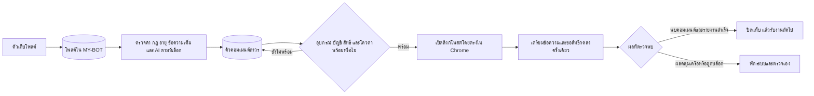

# ระบบคอมเมนต์จากโพสต์ใน MY-BOT — 1.11.12

ควบคุมที่ `/auto-comment` ตามเดิม อัปเดตเว็บและส่วนขยายให้ตรงรุ่นก่อนใช้งาน การอัปเดตไม่เปิดกฎ ไม่กด Start ไม่เปลี่ยนโควตา และไม่เริ่มส่งคอมเมนต์แทนเจ้าของ

## เส้นทางเดียวตั้งแต่รับโพสต์ถึงส่ง



ตัวส่งไม่เลื่อนฟีดเพื่อเลือกโพสต์ใหม่ ใช้โพสต์ที่บันทึกในฐานข้อมูลเท่านั้น Chrome ใช้เปิดโพสต์ที่ถูกเลือกแล้ว เตรียมข้อความ ตรวจหน้าจอ และกดส่งผ่าน UI ที่ระบบรองรับ

## แบ่งหน้าที่โดยใช้ระบบเดิม

| ส่วน | หน้าที่ | หลักฐานและการกู้คืน |
| --- | --- | --- |
| Collector | รับโพสต์และข้อมูลเนื้อหาเต็มเข้า MY-BOT | Outbox, checkpoint, item receipts และการตรวจซ้ำ |
| Worker / `AutoCommentEvaluation` | ตรวจเฉพาะโพสต์ที่ยังไม่ประเมินหรือข้อมูล/กฎเปลี่ยน | Fingerprint ของ input และ revision; checkpoint ถาวร ไม่เริ่มจากศูนย์ทุกครั้ง |
| `AutoCommentJob` | เก็บข้อความ กฎ อุปกรณ์ บัญชี และลิงก์เป้าหมาย | Unique live post key, generation/revision และ claim token |
| Extension | ส่งทีละโพสต์ที่เซิร์ฟเวอร์อนุญาต | Journal ก่อนส่ง, ข้อจำกัดเวลา และ session ownership ของแท็บ |
| หน้าควบคุมและประวัติ | เริ่ม/หยุด กฎ โควตา และเหตุผลที่รอ | สถานะงานและ audit logs ในฐานข้อมูล |

เงื่อนไขเดิมยังมีผล: แหล่งต้องเปิด อยู่ในกลุ่มที่อนุญาต ผ่านคำยกเว้น อายุโพสต์ ช่วงเริ่มงาน และข้อกำหนดบัญชี/อุปกรณ์ โพสต์ที่เก็บไว้ก่อนเริ่มรอบไม่ได้ถูกส่งย้อนหลังทั้งหมดโดยอัตโนมัติ กฎที่ชนะเลือกตามลำดับความสำคัญ หนึ่งโพสต์ไม่มีหลายงานส่งจริงจากหลายกฎ

ข้อความสำเร็จรูปเป็นเส้นทางที่ใช้ทรัพยากรน้อยที่สุด ถ้ากฎกำหนดให้รอ AI ระบบจะรอ ไม่ลดเงื่อนไขเอง โหมด AI Draft สร้างข้อความฝั่ง worker ตามข้อเท็จจริงธุรกิจที่เจ้าของรับรอง และใช้ draft fingerprint ป้องกันใช้ร่างหลังข้อมูลเปลี่ยน ไม่สร้างร่างใหม่จากทุกคำขอของ Chrome

## สิ่งที่ปรับเพื่อให้คิวเดินเร็วและไม่กักงาน

### รับงานต่อโดยไม่รอ alarm ทุกรายการ

เดิมแต่ละรอบ alarm 30 วินาทีรับเพียงหนึ่งงาน ตอนนี้ `drain()` รับต่อได้สูงสุด **3 งานต่อรอบ** แบบเรียงทีละงาน ภายในงบ 90 วินาที ไม่ preclaim หลายงาน ไม่เปิดหลายแท็บส่งพร้อมกัน และไม่ออกสิทธิ์หลายงานล่วงหน้า

รับงานถัดไปเฉพาะเมื่อพบคอมเมนต์พร้อมลิงก์และเซิร์ฟเวอร์ตอบรับรายงานของงานก่อนหน้าแล้ว ทุกงานยังขอ claim และ authorize ใหม่เพื่อตรวจ Stop, quota และ cooldown หากไม่มีงานพร้อม ผลไม่ชัดเจน ใบอนุญาตหมดอายุ รายงานล้มเหลว หรือเวลารอบเหลือน้อย จะจบรอบแล้วรอ alarm ถัดไป เงื่อนไขนี้ลดช่วงรอที่ไม่จำเป็น ไม่ใช่การเพิ่มโควตาหรือรับประกันความเร็วบน Facebook

### จำกัดเวลาต่อหนึ่งงาน

- งานหน้าเว็บใช้งบไม่เกิน 90 วินาทีตาม deadline ของ client และต้องเหลืออย่างน้อย 15 วินาทีก่อน claim หมดอายุสำหรับรายงานผล
- ใน drain ใช้ deadline ร่วม 90 วินาที รวมเวลาสำรองรายงาน ไม่เริ่มงานใหม่เมื่อเหลือไม่ถึง 45 วินาที
- โหลดหน้าใช้เวลาได้ไม่เกิน 25 วินาทีหรืองบที่เหลือ; DOM แต่ละครั้งมี timeout ไม่เกิน 5 วินาที
- ก่อน authorize ต้องเหลือเวลาเพียงพอ สิทธิ์กดส่งยังมีอายุไม่เกิน 3 วินาทีจากคำขอเดิม ไม่ต่ออายุจากเวลารับ response
- เครือข่ายและ DOM ที่หมดเวลายังรักษา journal; งานที่อาจกดส่งแล้วรายงานเป็น uncertain และไม่ส่งซ้ำ

Deadline ตรวจระหว่างขั้นตอนและใช้ timeout ของ transport ไม่ได้รับประกันว่าจะยกเลิกทุกคำสั่งที่ Chrome รับไปแล้ว Stop ยังอาจตามหลังสิทธิ์ที่ออกแล้วได้สูงสุดตามอายุ grant เดิม

### แบ่งเวลาของ worker

Worker สแกนโพสต์ในฐานข้อมูลก่อน แล้วเตรียมงาน โดยแต่ละส่วนมีงบ 5 วินาทีที่ตรวจ **ระหว่างโพสต์/งาน** ถ้าหมดงบจะคืนรอบและทำต่อจาก checkpoint ในรอบถัดไป ไม่ทิ้งงานและไม่สร้างงานซ้ำ

งบนี้เป็น cooperative budget ไม่ใช่ hard timeout ของทั้งฟังก์ชัน Query หรือ AI call ที่เริ่มไปแล้วใช้ timeout เดิมของตัวเองและอาจเกิน 5 วินาทีได้ ไม่ยกเลิก model call สั้นจน AI ท้องถิ่นสร้างร่างไม่สำเร็จทุกครั้ง และไม่ cache กฎจนข้ามการตรวจ revision ก่อนส่ง

## ลองใหม่เฉพาะกรณียืนยันว่าไม่เคยออกสิทธิ์ส่ง

หากเตรียมหน้าไม่สำเร็จ หรือ claim หมดอายุก่อน authorize สามารถลองเตรียมหน้าใหม่ได้ **2 ครั้ง** ที่ประมาณ 30 และ 60 วินาที เงื่อนไขทั้งหมดต้องเป็นจริงภายใต้ control lock:

- งานยังเป็น `claimed`, `attempts = 0`, `dispatchedAt = null`
- ระบบยังเปิดอยู่และ generation ยังตรงกัน
- ไม่ใช่ checkpoint/blocked และยังไม่เกินจำนวน retry

ใช้ job เดิมและ dedupe key เดิม เก็บจำนวน retry ใน `prepare_retry` logs ล้าง token เก่าแล้ว claim ใหม่ Token เก่าไม่สามารถขอสิทธิ์หรือเปลี่ยนงานที่ถูก claim ใหม่ได้ การลองเตรียมหน้าไม่ถูกนับเป็นการส่งและไม่เพิ่มโควตาเอง

เมื่อออกสิทธิ์แล้ว ไม่ว่าจะเป็น `not_sent`, `sending`, `uncertain` หรือพบคอมเมนต์ ระบบไม่ใช้เส้นทาง retry นี้ เมื่อครบจำนวนแล้วยังเตรียมหน้าไม่สำเร็จ งานยกเลิกให้ตรวจประวัติ ไม่ลองวนไม่สิ้นสุด และไม่รื้อ historical failed jobs มาเริ่มส่ง

## วัดผลและขอบเขตที่ยังต้องตรวจบนเครื่องจริง

ใช้ timings ใน worker log และเครื่องมืออ่านอย่างเดียวที่เพิ่มไว้แล้ว:

```powershell
npm.cmd run observe:automation -- --once
npm.cmd run observe:automation -- --hours=24 --interval-seconds=60
```

พิจารณา ingest→AI done→browser_ready→dispatch→observed, อายุคิว, overdue sources และสัดส่วน not_sent/uncertain ก่อนเพิ่มจำนวนงานต่อรอบ ค่า observed คือหลักฐานจาก DOM ไม่ใช่การยืนยันจาก API ไม่มีข้อสรุปว่าเร็วขึ้นกี่เท่าหรือเสถียรครบ 24 ชั่วโมงจากชุดทดสอบสังเคราะห์

`.env` บนเครื่องพัฒนายังเป็น SQLite เดิม การตรวจ production และ 24 ชั่วโมงจริงต้องตั้ง Supabase URL ผ่าน `.env` ก่อน ไม่ส่ง secrets ในแชต การส่ง Facebook จริงยังต้องได้รับอนุมัติแยก

## ตรวจสอบและย้อนกลับ

ทดสอบด้วย Chrome/API จำลองและ PostgreSQL disposable `test_*` schemas เท่านั้น ครอบคลุม drain เรียงลำดับ, การปฏิเสธงานถัดไปจาก server, grant หมดอายุ, งบสังเกตผล, checkpoint หลัง yield, retry ก่อน grant, token เก่า และการไม่ส่งซ้ำหลัง dispatch ไม่มี migration หรือตารางใหม่

หากต้องย้อนกลับ ให้หยุดจาก `/auto-comment` ก่อน เก็บฐานข้อมูลและประวัติ sending/dispatch ทั้งหมดไว้ แล้วอัปเดตเว็บและส่วนขยายเป็นรุ่นที่ตรงกัน ห้ามล้าง dedupe keys หรือรีเซ็ต uncertain เพื่อแก้คิว

ผลตรวจรอบนี้: `npm run test:ci` ผ่าน **758 tests**, ข้าม 4 ข้อเฉพาะ Linux/VNC บน Windows; `npm run build`, syntax checks และ `git diff --check` ผ่าน ESLint ของไฟล์ที่แก้ไม่มี error มี warning เดิมใน background.js หนึ่งรายการ ฐาน PostgreSQL ทดสอบถูกปิดแล้ว ยังไม่ commit/deploy หรือส่ง Facebook จริง

รอบแรกของชุดทดสอบรวมติด advisory lock ของ Prisma เพราะหลาย test schemas รัน migration พร้อมกัน จึงจำกัด strict runner ให้ใช้ไม่เกิน 4 workers โดยไม่ปิด advisory lock แล้วรันทั้งชุดผ่านใหม่
