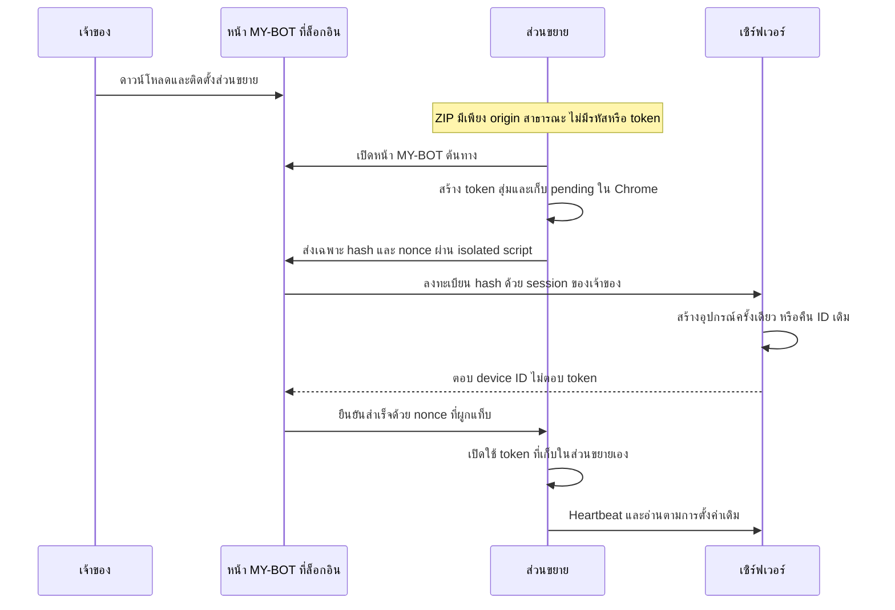

# ติดตั้งแล้วเชื่อมต่อ MY-BOT อัตโนมัติ — 1.11.13

ไม่ต้องพิมพ์ที่อยู่เซิร์ฟเวอร์หรือรหัสจับคู่ในส่วนขยาย ต้องอัปเดตเว็บและส่วนขยายให้เป็นรุ่นที่รองรับก่อนใช้งาน ฟีเจอร์นี้ไม่ข้ามรหัสผ่านเจ้าของ ไม่ล็อกอิน Facebook แทน และไม่เริ่มส่งคอมเมนต์เอง

## วิธีใช้

1. ล็อกอิน MY-BOT ที่ต้องการใช้ → **ตั้งค่า → ส่วนขยาย Chrome → ดาวน์โหลด .zip** ไฟล์จะจำเซิร์ฟเวอร์ต้นทางให้เอง ทั้ง HTTPS บนคลาวด์และ localhost
2. แตกไฟล์ → `chrome://extensions` → Developer mode → Load unpacked → เลือก `mybot-extension`
3. ส่วนขยายเปิด MY-BOT ให้เอง ถ้าล็อกอินอยู่แล้วจะเชื่อมต่อทันที ถ้าใช้ Chrome คนละโปรไฟล์หรือยังไม่ได้ล็อกอิน ให้ล็อกอิน MY-BOT ตามปกติ ระบบจะเชื่อมต่อให้หลังล็อกอิน
4. เปิด Facebook และล็อกอินบัญชีที่ต้องการใช้ ระบบอ่านตามกลุ่มและตารางที่ตั้งไว้ การส่งคอมเมนต์ยังต้องผูกอุปกรณ์/บัญชีในกฎและกด Start บนเว็บเอง

อัปเดตครั้งถัดไปให้แตกไฟล์ทับโฟลเดอร์เดิมแล้ว Reload ส่วนขยาย การจับคู่เดิมและสวิตช์พักยังอยู่ ไม่เปิดแท็บติดตั้งซ้ำทุกครั้งที่ Chrome หรือ worker เริ่มใหม่ หากต้องตรวจอีกครั้ง ให้กด **เปิด MY-BOT และเชื่อมต่ออัตโนมัติ** ใน popup หรือ **ตรวจการเชื่อมต่ออีกครั้ง** บนหน้าเว็บ

ถ้าต้องการใช้กับเซิร์ฟเวอร์อื่น ให้ดาวน์โหลดจาก MY-BOT เครื่องนั้น ไฟล์ที่โหลดจากโฟลเดอร์ `extension/` ในซอร์สตรง ๆ ยังใช้เซิร์ฟเวอร์ Render ค่าเริ่มต้นตาม `install-config.json` วิธีใส่รหัสเดิมยังอยู่ในเมนูพับสำหรับส่วนขยายรุ่นเก่า ไม่ใช่ขั้นตอนที่ต้องทำในรุ่นนี้

## แบบการเชื่อมต่อ

ข้อมูลประจำอุปกรณ์สร้างจาก `crypto.getRandomValues` 32 bytes ใน worker เก็บ token ไว้ใน `chrome.storage.local` เท่านั้น หน้าเว็บไม่รับ token และไม่เก็บ token ลง DOM หรือ web localStorage ฝั่งเซิร์ฟเวอร์เก็บ SHA-256 hash กับ hint แบบปิดบังตามระบบอุปกรณ์เดิม

`POST /api/extension-devices/connect` ต้องมี owner session ที่ยังใช้ได้, Origin ตรงกับเว็บ, transport เป็น HTTPS หรือ loopback และ JSON schema ที่ยอมรับเฉพาะ hash/hint/name ไม่รับ token ใน body ไม่มี endpoint ลงทะเบียนแบบสาธารณะที่ข้ามการล็อกอิน

การยืนยันใน worker ตรวจ origin ของ sender, main frame, tab ID, nonce ที่มีอายุ 2 นาที และ hash ของ pending เดิม ไม่รับ token ที่หน้าเว็บส่งมาแทน ไม่เพิ่ม `cookies`, `debugger` หรือ externally_connectable permissions เซิร์ฟเวอร์ custom ถูกระบุใน manifest ตอนดาวน์โหลด และ Chrome ตรวจสิทธิ์ตามขั้นตอนติดตั้งปกติ ไม่ขอ host permission เพิ่มแบบเงียบ ๆ

## การกู้คืนและการยกเลิก

- ถ้า response หลุดหรือแท็บโหลดซ้ำ ใช้ pending hash เดิม เซิร์ฟเวอร์ใช้ unique `tokenHash` และ `createMany(skipDuplicates)` เพื่อไม่สร้างอุปกรณ์ซ้ำ
- การเชื่อมต่อหลายแท็บถูกจัดลำดับใน worker ใช้ nonce แยกต่อคำขอ Token เก่าหรือการตอบกลับจากเซิร์ฟเวอร์ที่เปลี่ยนไปจะไม่ทับการจับคู่ปัจจุบัน
- อุปกรณ์ที่ถูก revoke ไม่ถูกลงทะเบียนคืน การเรียกซ้ำด้วย hash เดิมได้ 403 และไม่ล้าง `revokedAt`
- การติดตั้ง/อัปเดตไม่เปลี่ยน token ที่มีอยู่ ไม่ล้าง pause, outbox, journal หรือกฎคอมเมนต์
- ถ้าเว็บหรือฐานข้อมูลยังไม่พร้อม แสดงเหตุผลและเก็บ pending ไว้ ลองใหม่ได้เมื่อกลับมาโฟกัสหน้า MY-BOT หรือกดตรวจอีกครั้ง ไม่จำเป็นต้องพิมพ์ URL/รหัสเพื่อแก้เครือข่ายชั่วคราว

เซิร์ฟเวอร์กับ Chrome ยังต้องเปิดอยู่ และ Facebook ต้องล็อกอินตามเดิม การติดตั้งส่วนขยายไม่ติดตั้งหรือเปิดโปรแกรมเซิร์ฟเวอร์บน OS ให้แทน

## ผลตรวจ

- ชุดทดสอบรวมบน PostgreSQL disposable schemas ผ่าน **773 ข้อ** ข้าม 4 ข้อเฉพาะ Linux/VNC; TypeScript และ ESLint ของไฟล์ใหม่/ไฟล์ที่แก้ผ่าน
- ติดตั้งส่วนขยายจริงใน Chromium for Testing โปรไฟล์แยก: เปิดหน้า login อัตโนมัติ → ล็อกอินบัญชีสังเคราะห์ → เชื่อมต่อเอง → จำลอง response ลงทะเบียนหลุด → กู้สำเร็จโดยมีอุปกรณ์เพียง 1 รายการ
- ตรวจแล้ว token อยู่เฉพาะส่วนขยาย ไม่มีใน DOM/web localStorage และการติดตั้งไม่เปิดระบบคอมเมนต์
- Popup ซ่อนช่อง URL/รหัสในเส้นทางหลัก หน้าตั้งค่าขนาดมือถือไม่มี horizontal overflow และไม่มี page error
- พบและแก้ hydration ของ origin ในเมนูเดิม โดยเริ่ม state ให้ตรง SSR แล้วเติม origin หลัง mount; `<html>` ยอมรับเฉพาะ marker attributes ที่ส่วนขยายเพิ่มก่อน hydration ไม่ปิดการตรวจ child content
- Build ผ่านหลังปิด Next ทดสอบเพื่อปลดล็อก Prisma DLL บน Windows ไม่ส่งคอมเมนต์จริง ไม่แก้ `.env` และยังไม่ deploy

หลักฐานเบราว์เซอร์อยู่ใน `.playwright-cli/connect-settings.png`, `connect-popup.png` และ `connect-mobile.png` ซึ่ง gitignore แล้ว ฐาน/browser profile ทั้งหมดเป็นข้อมูลสังเคราะห์ ไม่ใช้ session หรือ Facebook ของเจ้าของ
