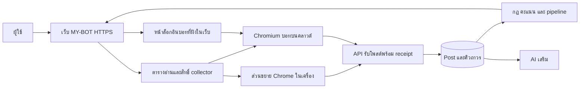

# ออกแบบตัวเก็บโพสต์บน production

สถานะ: แบบเสนอ ยังไม่ใช่ฟีเจอร์ที่เปิดใช้งาน ไม่อนุมัติ deploy ย้าย session Facebook หรือส่งคอมเมนต์จริง

## เป้าหมายและข้อจำกัด

ผู้ใช้เปิดเว็บ MY-BOT บน HTTPS ติดตั้งส่วนขยาย ล็อกอิน Facebook แล้วเก็บโพสต์ได้ โดยไม่ติดตั้ง Node, WSL, VNC หรือใช้ localhost บนเครื่องผู้ใช้

ต้องแยกสามกรณี: ปิดหน้า MY-BOT ทำได้โดย collector ยังอยู่; ย่อ/บัง Chrome ส่วนขยายอาจอ่านได้ช้าลง; ปิด Chrome ทั้งโปรแกรมหรือปิดเครื่อง ตัวอ่าน DOM ในเครื่องนั้นทำงานต่อไม่ได้ การย้าย backend ไป Render ไม่ได้ย้าย browser/session ไปด้วย ระบบ VNC ปัจจุบันปิดได้เฉพาะ viewer ส่วน Chromium บอทต้องยังทำงานในจอเสมือน

## ทางเลือกของผลิตภัณฑ์

1. **ส่วนขยายในเครื่อง:** ขั้นตอนตรงตามเปิดเว็บ–ติดตั้งส่วนขยาย–ล็อกอิน Facebook ไม่มีโปรแกรมเสริม แต่ต้องเปิด Chrome อยู่ ไม่รับรองอัตราการอ่านขณะถูกซ่อนเท่ากับ foreground
2. **เบราว์เซอร์บอทบนคลาวด์:** ปิด Chrome หรือเครื่องส่วนตัวได้ โดย browser บนเซิร์ฟเวอร์ยังทำงาน ต้องให้ผู้ใช้ล็อกอิน Facebook ภายใน browser นั้นแยกครั้งแรก ไม่สามารถใช้ login ใน Chrome ส่วนตัวแทนโดยอัตโนมัติ

เสนอให้รองรับทั้งคู่ด้วยสัญญา collector เดียว แต่เลือกผู้รับผิดชอบแหล่งข้อมูลได้ชัดเจน สำหรับเป้าหมายปิด Chrome แล้วเก็บต่อจริง ต้องเลือกข้อ 2 การไม่มีโปรแกรมเพิ่มในเครื่องผู้ใช้ยังทำได้ เพราะเราดูแล runtime และจอเสมือนฝั่งเซิร์ฟเวอร์

## โครงสร้าง

เว็บ/API และ worker ใช้การติดตั้ง production เดิม แยก cloud browser ไปเครื่อง/VM ที่มีทรัพยากรและ storage ถาวร มี Chromium แบบมีหน้าจอ จอเสมือน และ extension build เดียวกับในเครื่อง ไม่สร้าง Facebook scraper อีกชุดที่ทำพฤติกรรมต่างกัน แยกโปรไฟล์และสิทธิ์ filesystem ตามเจ้าของเมื่อรองรับหลายบัญชีผู้ใช้

## ขั้นตอนใช้งาน

ส่วนขยาย: แจกผ่าน Chrome Web Store หลังผ่านการเผยแพร่ของร้าน เพื่อติดตั้ง/อัปเดตง่าย เว็บ production เชื่อมอุปกรณ์อัตโนมัติตาม flow 1.11.13 ไม่ให้กรอก API URL หรือ token เปิด Facebook แล้วล็อกอินตามปกติ เซิร์ฟเวอร์ต้องเห็นการยืนยันบัญชีจริงก่อนบอกว่าพร้อม

คลาวด์: ผู้ใช้กด “เปิดบอททำงานต่อเนื่อง” → ระบบสร้าง browser profile → แสดง browser ในหน้า MY-BOT ผ่านช่องดูจอที่ยืนยันตัวตน → ผู้ใช้ล็อกอิน Facebook และจัดการ 2FA/checkpoint เอง → ตรวจบัญชีและกลุ่ม → ยืนยันเริ่มเก็บโพสต์ หลังจากนั้นปิดหน้าดูจอและเครื่องส่วนตัวได้ ไม่ต้องติดตั้ง VNC client หรือโปรแกรมเพิ่ม

การล็อกอินคลาวด์เป็นขั้นตอนจำเป็น ไม่คัดลอก cookies/session/token จาก Chrome ส่วนตัว ไม่รับรหัสผ่าน Facebook ลงแบบฟอร์ม MY-BOT ไม่บันทึกแป้นพิมพ์ ภาพหน้าจอรหัสผ่าน หรือบันทึกการดูจอ

## การอ่านโดยไม่รบกวนและการกู้ข้อมูล

- ส่วนขยายในเครื่องไม่เรียก focus หน้าต่างเจ้าของและไม่คืนหน้าต่างที่เจ้าของย่อโดยพลการ เปิดเฉพาะ reader ที่ตนเป็นเจ้าของแบบไม่แย่ง focus
- หาก Chrome ลดการทำงาน ให้รายงาน “อ่านช้าลง/รอเบราว์เซอร์” และรักษา checkpoint ไม่แย่งหน้าจอเพื่อทำให้สถานะดูปกติ ไม่อ้างว่าการปิด Memory Saver หรือ Offscreen API รับประกัน Facebook lazy loading
- Browser คลาวด์มีจอของตนเอง จึงเปิด/สลับหน้าได้โดยไม่กระทบหน้าจอผู้ใช้ แต่ยังต้องวัด Facebook จริง ไม่รับรองความเร็วจากสถาปัตยกรรมอย่างเดียว
- เก็บ lease ตามแหล่งข้อมูลและ Facebook account พร้อม generation ป้องกันเครื่องส่วนตัวกับคลาวด์อ่านแหล่งเดียวกันพร้อมกันโดยไม่ตั้งใจ ให้ผู้ใช้เลือกอุปกรณ์หลักและลำดับสำรองอย่างชัดเจน
- ใช้ post key, idempotency, batch receipts, durable outbox และ deep recovery เดิม API ยอมรับเฉพาะบัญชี/แหล่ง/lease ที่มีสิทธิ์ การเปลี่ยนเจ้าของ lease ไม่ลบ pending ของ collector เก่า สามารถระบาย batch เก่าที่ตรวจสิทธิ์และ fencing แล้วได้ตามกติกาที่ต้องกำหนดก่อน implement
- Chrome/เครือข่ายกลับมาให้ซ่อม alarms และ resume checkpoint ห้ามแปล `limit`, `loading`, `stalled` เป็นอ่านครบ ไม่ reset โควตาหรือเพิ่มจำนวนแท็บโดยอัตโนมัติ

## ความปลอดภัยและคอมเมนต์

บริการดูจอเปิดผ่าน HTTPS gateway ของเว็บเท่านั้น พอร์ต VNC ดิบต้องเป็น loopback ภายในเครื่องบอท ไม่เปิด 5905/6085 ต่อสาธารณะ ตรวจ owner session, origin, nonce, อายุช่องเชื่อมต่อ และการหมดสิทธิ์ใน WebSocket ด้วย ไม่ใส่สิทธิ์ถาวรใน URL หรือ logs

เข้ารหัส volume/profile กำหนดสิทธิ์เฉพาะบริการ ไม่รวมโปรไฟล์ browser ใน backup ทั่วไป ให้ผู้ใช้ตัดอุปกรณ์/ลบ session ได้ ไม่เข้าถึงบัญชีเจ้าของอื่น ไม่ปิด Chrome sandbox ไม่ใช้ private Facebook API หรือข้าม CAPTCHA/checkpoint

การเก็บโพสต์และการส่งคอมเมนต์แยกสิทธิ์กัน cloud collector เริ่มแบบอ่านอย่างเดียว การย้ายตัวอ่านไม่ย้าย pinned device/account หรือ consent ของกฎคอมเมนต์อัตโนมัติ หากจะให้ cloud browser ส่งจริง เจ้าของต้องเลือกอุปกรณ์ใหม่และอนุมัติแยก คง durable sending และ uncertain-send journals ห้ามใช้การ restart/failover เป็นเหตุให้ retry dispatched/uncertain งานส่ง

## สถานะและเกณฑ์ตรวจรับ

หน้าเดียวแสดง: อุปกรณ์หลัก, Facebook login ที่ตรวจล่าสุด, รอบอ่านล่าสุดแยกแหล่ง, capture/ingest ล่าสุด, pending พร้อมอายุ, checkpoint, incomplete coverage และเหตุที่ต้องให้เจ้าของช่วย แยก “ออนไลน์” ออกจาก “อ่านคืบหน้า”

ทดสอบส่วนขยายใหม่จากเว็บ production โดยไม่มี .env/localhost/WSL และ Chrome profile ใหม่ การปิดหน้า MY-BOT ต้องไม่หยุดตัวอ่าน ขณะย่อ Chrome ต้องไม่มีการขโมย focus และรายงานความคืบหน้าจริง หากปิด Chrome ทั้งโปรแกรม ให้ local collector เป็น offline ไม่รายงานว่าเก็บต่อ

ทดสอบคลาวด์ด้วยการปิด Chrome/เครื่องส่วนตัว แล้ววัดโพสต์ที่รับจริงและการเดินครบแหล่งอย่างน้อย 30 นาที ก่อนทดสอบระยะยาว 24 ชั่วโมง ตรวจ resume หลังเน็ตหลุด/VM restart/extension worker restart การสลับอุปกรณ์ไม่ทำโพสต์ซ้ำหรือทิ้ง pending ทดสอบ Facebook logout/checkpoint ว่าหยุดและขอเจ้าของช่วย ไม่มีการส่งคอมเมนต์จริงในการตรวจรับการเก็บโพสต์

## ลำดับพัฒนา

1. ทำ production onboarding ของส่วนขยายให้ครบและปิดเส้นทางแย่ง focus ในโหมดเครื่องส่วนตัว โดยไม่อ้างว่าทำงานได้หลัง Chrome ปิด
2. เพิ่ม cloud browser runtime กับหน้า “เชื่อม Facebook ของบอท” บนเว็บ ทดสอบอ่านอย่างเดียวหนึ่งเจ้าของก่อน
3. เพิ่ม collector lease/fencing และการเลือกอุปกรณ์หลัก ตรวจ failover และ pending ข้ามอุปกรณ์
4. เพิ่มการวัด coverage/latency และแจ้งเฉพาะปัญหาที่ต้องช่วย ทดสอบ soak จนครบเกณฑ์ก่อนให้เปิดทั่วไป

## แหล่งอ้างอิง

- Chrome service worker lifecycle: https://developer.chrome.com/docs/extensions/develop/concepts/service-workers/lifecycle/
- Chrome alarms และข้อจำกัดเมื่อเครื่อง sleep: https://developer.chrome.com/docs/extensions/reference/api/alarms
- Offscreen document มีข้อจำกัด ไม่ใช่ browser session อิสระ: https://developer.chrome.com/docs/extensions/reference/api/offscreen
- Background throttling: https://blog.chromium.org/2020/11/tab-throttling-and-more-performance.html
- การเชื่อมส่วนขยายอัตโนมัติที่มีอยู่: EXTENSION-AUTO-CONNECT.th.md
