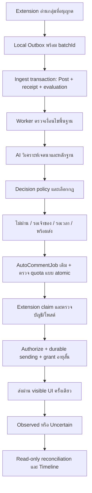

# แบบระบบคอมเมนต์อัจฉริยะ MY-BOT

วันที่ออกแบบ: 7 พฤศจิกายน 2026 — สถานะ: ข้อกำหนดสำหรับพัฒนา ไม่ใช่รายการฟีเจอร์ที่ติดตั้งแล้ว

อัปเดตรอบพัฒนาถัดจากการออกแบบ: เพิ่ม intent modes, priority และ durable evaluation แล้วในโค้ด ดู [สิ่งที่ทำแล้วและวิธีติดตั้ง](SMART-COMMENT-SETUP.th.md) ส่วนโครงสร้างและฟีเจอร์อื่นด้านล่างยังเป็นเป้าหมาย ไม่ได้ติดตั้งครบทั้งหมด

## เป้าหมายและขอบเขต

ให้เจ้าของกำหนดกลุ่ม เป้าหมายทางธุรกิจ ข้อความ และขอบเขตการส่งครั้งเดียว จากนั้นระบบรวบรวมโพสต์ ประเมินความเกี่ยวข้อง เตรียมคำตอบ และให้ Extension ส่งผ่านหน้าจอที่เจ้าของมีสิทธิ์ใช้งาน พร้อมตรวจสอบย้อนหลังว่าแต่ละโพสต์จบที่สถานะใด

ต่อยอด Next.js, Prisma, PostgreSQL, Worker Lease, AutoCommentRule/Job/Log และ Extension เดิม ไม่สร้างเครื่องยนต์ส่งชุดที่สอง ไม่จำเป็นต้องเพิ่ม Redis หรือแยก microservice ในระยะแรก เพราะฐานข้อมูลมี durable queue และตัวล็อกอยู่แล้ว

คำว่าไม่ตกหล่นหมายถึงโพสต์ที่เซิร์ฟเวอร์รับสำเร็จทุกเวอร์ชันมีผลประเมินหรืองานรอที่ตรวจสอบได้ ไม่รับรองว่า Chrome จะเห็นทุกโพสต์ในกลุ่ม หรือ Facebook จะอนุญาตและเผยแพร่ทุกคอมเมนต์ Chrome ต้องเปิด เครื่องต้องตื่น Extension ต้องเชื่อมต่อ และบัญชีต้องยังใช้งานได้ การ deploy เซิร์ฟเวอร์อย่างเดียวไม่ทำให้เบราว์เซอร์บนเครื่องเจ้าของทำงาน

## หลักฐานจาก BOT-W

ตรวจหน้าสาธารณะวันที่ออกแบบ:

| ระดับ | สิ่งที่พบ | หลักฐาน/ขอบเขต |
| --- | --- | --- |
| Verified: คำประกาศบนเว็บ | หมวดหมู่ คำค้นหา พื้นที่ ฟีด แจ้งเตือน และลดโพสต์ซ้ำ | [หน้าแรก](https://bot-w.com/) เป็นคำอธิบายผลิตภัณฑ์ ไม่ใช่ผลทดสอบการใช้งาน |
| Verified: คำประกาศบนเว็บ | Extension, คอมเมนต์อัตโนมัติ, กฎ, ข้อความสำเร็จรูป และแนบรูปปรากฏในหน้าแพ็กเกจ | [ราคาและแพ็กเกจ](https://bot-w.com/pricing) ไม่ยืนยัน transport หรือความแม่นยำ |
| Inferred | ควรมีขั้นตอนจับคู่โพสต์กับกฎและเลือกข้อความ | ข้ออนุมานเพื่อออกแบบ MY-BOT ไม่ใช่สถาปัตยกรรม BOT-W ที่ตรวจพบ |
| Unknown | วิธีส่งจริง การจัดคิว การใช้ AI การยืนยันผล และอัตราความสำเร็จ | ยังไม่ได้ตรวจหลังล็อกอิน ไม่ใช้รหัสผ่านจากแชต ไม่คัดลอกโค้ดหรือเรียก API ส่วนตัว |

จึงนำแนวคิดการใช้งานมาเป็นตัวอย่าง แต่ข้อกำหนดด้านความน่าเชื่อถือด้านล่างออกแบบขึ้นเอง ไม่อ้างว่าทำงานเหมือนหรือดีกว่า BOT-W แล้ว

## จุดที่โค้ดปัจจุบันต้องปรับ

| ความสำคัญ | หลักฐานในโค้ด | ผลกระทบ | การเปลี่ยนที่เสนอ |
| --- | --- | --- | --- |
| P0 | `src/lib/auto-comment/browser.ts:scanBrowserComments` เลื่อน cursor ตาม createdAt หลังตรวจ matcher | โพสต์ที่ไม่ผ่านก่อน AI เสร็จอาจไม่มีงานให้ประเมินใหม่ | บันทึก evaluation สำหรับทุกโพสต์ที่รับ แล้วกระตุ้นใหม่เมื่อ textRevision/AI/rule เปลี่ยน |
| P0 | `src/lib/auto-comment/matching.ts:explainCommentRule` ใช้ includes และปฏิเสธ isAd ทุกกรณี | “ไม่ขาย” ตรง “ขาย”; กฎหาผู้ขายอาจถูกตัวกรองโฆษณาตัด | เพิ่ม intent/negation policy ต่อกฎ แยก seller ออกจาก spam โดยคง global forbidden gate |
| P0 | `src/lib/auto-comment/browser.ts:reportBrowserComment` ยืนยันไม่ได้จะเป็น uncertain | การกดส่งกับการมองเห็นคอมเมนต์เป็นคนละเหตุการณ์ | เพิ่มหลักฐานตรวจผลและคิวตรวจซ้ำแบบอ่านอย่างเดียว ห้ามส่งซ้ำเมื่อคลุมเครือ |
| P1 | `scanBrowserComments` เลือกกฎตาม createdAt แล้วหยุดที่กฎแรก | กฎที่สร้างก่อนอาจแย่งโพสต์จากกฎที่ตรงกว่า | priority ชัดเจนและบันทึกเหตุผลการเลือก/ไม่เลือกทุกกฎ |
| P1 | `prepareBrowserComments` รอ AI ด้วย nextAttemptAt แต่ไม่มีผลประเมินครบทุกโพสต์ | งานรออาจยืดเยื้อและหาเหตุผลยาก | deadline, reasonCode, retry budget และหน้าติดตามงานค้าง |

คง unique live post key, generation/revision fencing, control lock, worker lease, durable sending และ local journal เดิมทั้งหมด การพบปัญหา observer ไม่อนุญาตให้ล้าง dedupe เพื่อส่งซ้ำ

## ขั้นตอนใช้งานที่ออกแบบ

1. **เชื่อมต่อเครื่อง**: ใส่ AI key ใน Settings จับคู่ Extension ตรวจเวอร์ชัน บัญชี Facebook และสถานะ Worker แสดงว่าเครื่องใดจะทำหน้าที่ส่ง
2. **กำหนดเป้าหมาย**: เลือกกลุ่มที่อนุญาต ตัวอย่าง “ต้องการซื้อของจากโพสต์ขาย” หรือ “เสนอบริการให้คนกำลังหา” พร้อมคำหลัก คำยกเว้น หมวด พื้นที่ และอายุโพสต์
3. **กำหนดคำตอบ**: เลือกข้อความคงที่/Template หรือ AI Draft จากข้อมูลธุรกิจที่เจ้าของรับรองเท่านั้น กำหนดเวลา โควตา ลำดับความสำคัญ และนโยบายโพสต์เก่า
4. **ทดลองแล้วเปิด**: Preview แสดงโพสต์ตัวอย่างและเหตุผล → Dry Run จากโพสต์จริงที่รับเข้ามาโดยไม่ส่ง → เจ้าของอนุมัติเปิดกฎและ local opt-in ที่เครื่อง → เริ่มส่งตามคิว

หน้าแต่ละกฎแสดงจำนวนรับเข้า ผ่าน ไม่ผ่าน รอ AI รอโควตา ส่งแล้วสังเกตพบ และต้องตรวจเอง สามารถเปิด Timeline ของโพสต์เพื่อดูข้อความฉบับที่จะส่งและเหตุผล ไม่แสดงเพียงตัวเลข “สำเร็จ” รวมกัน

## สถาปัตยกรรมและลำดับงาน

การเขียน Post กับ receipt/evaluation ต้อง commit ใน transaction เดียวกัน หากวิเคราะห์ AI นานให้ทำนอก transaction แล้ว compare-and-set ผลกลับด้วยเวอร์ชัน ห้ามถือ control lock ระหว่างเรียก AI หรือรอ DOM

### รับโพสต์และตรวจงานหาย

- Extension ส่ง batchId + itemKey คงที่ต่อรายการ เซิร์ฟเวอร์ตอบ receipt ต่อรายการว่า accepted/duplicate/rejected พร้อมเหตุผล ลบจาก Outbox เฉพาะรายการที่ได้รับคำตอบถาวร
- Network timeout ส่ง batch เดิมซ้ำได้ด้วย idempotency; 401/403 พักเพื่อแก้การเชื่อมต่อ ไม่ล้างข้อมูลอัตโนมัติ
- Coverage ต่อ source ระบุเวลารันล่าสุด จุดหยุด cap/known/age/error และเวลา checkpoint; sweep ซ้อนช่วงเวลาเพื่อเก็บโพสต์ที่เพิ่งแสดงภายหลัง โดย dedupe ตาม post key
- เมื่อเต็มขีดจำกัด Outbox ต้องเตือนและหยุดรับเพิ่มอย่างชัดเจน ข้อมูลที่หมดอายุมี lost/expired counter ไม่อ้างเก็บครบ
- Worker ทำ repair sweep หา Post revision ที่ไม่มี evaluation และงานหมด lease; cursor ใช้เพิ่มประสิทธิภาพได้ แต่ไม่เป็นหลักฐานเดียวว่างานครบ
- การแก้กฎสร้างงานประเมินใหม่เฉพาะช่วงที่เลือก ค่าเริ่มต้นใช้กับโพสต์ใหม่เท่านั้น โพสต์ย้อนหลังต้อง preview และเจ้าของเลือกเอง ไม่เปิดย้อนหลังทั้งหมดเมื่อกด Start

### การตัดสินใจอัจฉริยะ

ตรวจตามลำดับ: แหล่งที่อนุญาต/บัญชี/ข้อห้าม → วันเวลาและอายุ → คำหลักและคำยกเว้น → เจตนา/หมวด/พื้นที่ → เลือกกฎ → สร้างข้อความ → ตรวจพร้อมส่ง

ตัวอย่างกฎ “พบคนขายแล้วตอบ สนใจ”:

| โพสต์ | ผลที่ต้องได้ |
| --- | --- |
| ขายโต๊ะมือสอง 800 บาท | seller + คำขายตรง + กลุ่มถูกต้อง → เตรียม “สนใจ” |
| ไม่ขายแล้วครับ | negation → skip พร้อมหลักฐานข้อความ |
| หาซื้อโต๊ะ ใครขายบ้าง | buyer → ไม่ผ่านกฎ seller แม้มีคำขาย |
| ขายแล้ว ปิดการขาย | closed → skip |
| รับขายฝากบ้าน | intent ไม่ชัด/หมวดไม่ตรง → review หรือ skip ตามกฎ |
| ขายโต๊ะ แต่โพสต์เกินอายุที่กำหนด | expired → ไม่ส่ง |

AI คืน JSON ที่ validate ด้วย schema: intent, relevant, category, location, closed, negated, evidence[], confidence, reasonCodes และ draft เมื่อร้องขอ evidence ต้องอ้างช่วงข้อความที่มีอยู่จริง ห้ามให้ข้อความโพสต์สั่งเปลี่ยนกฎ เรียกเครื่องมือ หรือเปิดเผย secret

คะแนนจากโมเดลเป็นเพียงสัญญาณ ไม่ใช่ความน่าจะเป็นที่รับรองแล้ว ค่าเริ่มต้นสำหรับทดลอง: confidence ≥0.90 และหลักฐานครบจึงเสนอ auto; 0.65–0.89 ขอเจ้าของตรวจ; ต่ำกว่านั้นไม่ส่ง ต้องปรับจากชุดประเมินภาษาไทยที่เจ้าของติดป้ายก่อนเปิดจริง เงื่อนไขเด็ดขาดห้ามให้คะแนน AI ลบล้าง

Provider chain ใช้ระบบเดิมและตั้งค่าตามเครื่อง: Ollama/Gemini/Groq พร้อม timeout/circuit breaker และงบต่อวัน หาก requireAi แล้วทุก provider ล้มเหลวให้ waiting_ai จนถึง deadline จากนั้น needs_review ไม่เปลี่ยนเป็นส่งด้วย keyword เงียบ ๆ กฎ template ที่ไม่บังคับ AI ใช้งานได้ตามเงื่อนไขที่เจ้าของเลือก

AI Draft ต้องแยกจาก suggestedReply ทั่วไป: ผูก post textRevision + rule revision + business facts version + model/prompt version ให้ตรวจสอบซ้ำได้ ห้ามแต่งราคา สต็อก รับประกัน หรือช่องทางติดต่อที่ไม่มีในข้อมูลเจ้าของ

## สถานะและการรับประกัน

| ชั้น | สถานะเสนอเพิ่ม | การดำเนินการ |
| --- | --- | --- |
| Evaluation | pending, waiting_ai, evaluated, needs_review, superseded | บันทึกผล accept/skip/defer และ reasonCode; revision เก่าห้ามสร้างงานส่ง |
| Delivery เดิม | pending_ai, browser_ready, claimed | เพิ่ม waitReason/nextAttemptAt/deadline แทนสร้างสถานะซ้ำโดยไม่จำเป็น |
| Delivery เดิม | sending | มี durable marker ก่อน grant; ยังไม่เท่ากับ Facebook รับหรือเผยแพร่ |
| Delivery เดิม | browser_observed | พบคอมเมนต์ของบัญชีที่ถูกต้องใต้โพสต์เป้าหมาย พร้อม evidence; ไม่อ้างการมองเห็นต่อทุกคน |
| Delivery เดิม | uncertain | อาจส่งแล้ว ห้าม retry ส่ง; อ่านตรวจใหม่หรือให้เจ้าของยืนยัน |
| Delivery เดิม | dry_run, cancelled | เก็บเหตุผลและประวัติ ไม่รวมในยอดส่งจริง |

ก่อน durable sending อาจ retry เฉพาะความล้มเหลวที่พิสูจน์ว่าไม่เกิดผลข้างเคียง หลังส่ง grant หรือผลกำกวมใช้ read-only reconciliation เท่านั้น ไม่รับรอง exactly-once บน Facebook เพราะไม่มี idempotency จากหน้าจอปลายทาง แต่ป้องกันการกดซ้ำโดยระบบด้วย live key และ journal

เมื่อข้อความหรือกฎเปลี่ยน ให้ supersede evaluation เก่าและยกเลิกเฉพาะงานยังไม่ส่ง ห้ามเปลี่ยน snapshot ของงาน sending การประเมินใหม่ไม่สามารถลบประวัติ live dispatch เพื่อส่งโพสต์เดิมอีก

## การจัดคิวและยืนยันผล

- ส่งทีละงานต่อ device/account; ทำ fairness ระหว่างกลุ่มด้วย priority + aging ไม่ปล่อยกลุ่มใหญ่ยึดคิวทั้งหมด
- จองโควตา global/account/group/rule ใน transaction ก่อน authorize; นับการ authorize ที่อาจเกิดการส่งรวม uncertain เพื่อไม่เกินงบ ไม่คิดเฉพาะ observed
- เมื่อเกินโควตาเลื่อน nextAttemptAt; ถึง deadline ให้ expired/review พร้อมแจ้งเตือน ไม่ปล่อยงานเงียบและไม่ฝืนส่งทั้งหมดทันที
- ตรวจข้อความเป้าหมายและบัญชีในหน้าอีกครั้งก่อนขอ grant; DOM เปลี่ยน บัญชีผิด ปุ่มกำกวม CAPTCHA/checkpoint หรือกลุ่มไม่ตรงให้หยุด ไม่พยายามหลบ
- คง grant สูงสุด 3 วินาที, generation fencing และ local consent เดิม Stop ป้องกัน grant ใหม่ แต่ grant ที่ออกแล้วอาจกดได้ในช่วงอายุที่เหลือ
- Observer ยืนยัน author + normalized message + post identity + comment permalink เมื่อมี และเวลาในขอบเขต attempt; ห้ามถือว่าเห็นข้อความใน composer คือสำเร็จ หากหลักฐานไม่พอให้ uncertain
- Reconciliation อ่านเฉพาะโพสต์เป้าหมาย จำนวนครั้งและเวลาจำกัด ไม่คลิกส่ง ไม่มี private GraphQL; หากต้องขยาย UI ที่อาจเปลี่ยนข้อมูลให้รอเจ้าของ
- การส่งผ่าน visible UI อาจต้องโฟกัส Chrome ให้มีสถานะแจ้งเจ้าของและเวลาทำงานที่ยอมรับได้ ไม่รับรองว่าส่งจากแท็บเบื้องหลังได้ทุกครั้ง

## โครงสร้างข้อมูลและ API ที่เสนอ

เพิ่มแบบ additive โดยออก migration หลังลงมือพัฒนา ไม่รันกับ production ในรอบออกแบบ:

| ส่วน | ข้อมูลสำคัญ/ข้อจำกัด |
| --- | --- |
| IngestReceipt | deviceId, batchId, itemKey, postId, outcome, reasonCode; unique(deviceId,batchId,itemKey); retention ตามนโยบาย |
| CommentEvaluation | postId, textRevision, ruleId, ruleRevision, policyVersion, analysisVersion, state, decision, reasonCodes, evidenceJson, nextAttemptAt, deadline, claimToken/claimUntil; unique ตามเวอร์ชันทั้งหมด; index(state,nextAttemptAt) |
| CommentDecision | evaluationId, winner/loser reason, frozen draft, factsVersion, provider/model/promptVersion; ผล immutable, ไม่บันทึก key หรือ reasoning ภายในโมเดล |
| AutoCommentRule เดิม | เพิ่ม priority, intentPolicyJson, confidencePolicyJson, deadline/AI budget; ค่า default migration ต้องรักษาความหมายกฎเก่า ห้ามเปลี่ยนเป็น auto ใหม่ |
| AutoCommentJob เดิม | เพิ่ม decisionId, waitReason, deadline และ evidence summary โดยคง dedupeKey เดิม |
| CommentAttempt | jobId, attemptId, claim/generation, authorizedAt, outcome, evidenceJson; UNIQUE ตาม attempt; ไม่เปิดช่องส่งซ้ำงาน uncertain |

เปิด RLS ทุกตารางใหม่ ใช้ auth/device scope เดิม และเพิ่มใน backup/restore; restore ต้องหยุด automation และทำให้ grant/lease เดิมใช้ไม่ได้ หลักฐานเก็บเท่าที่จำเป็น ไม่เก็บ cookies/password/token หรือภาพ Facebook ทั้งหน้าตลอดเวลา

API เจ้าของที่เสนอ: `GET /api/auto-comment/evaluations`, `GET /api/auto-comment/jobs/:id/timeline`, `POST /api/auto-comment/rules/:id/simulate`, `POST /api/auto-comment/evaluations/:id/review` ทุก mutation ตรวจ session/origin และ revision

API Extension ใช้ `/api/v1/extension/comments` เดิมสำหรับ claim/authorize/report และขยาย report version/evidence แบบ backward compatible; receipt เพิ่มใน ingest เดิม ไม่สร้าง endpoint สั่งส่งที่ข้าม authorization การ review ไม่สามารถสั่ง resend งาน uncertain ได้

## แผนพัฒนาและเกณฑ์ตรวจรับ

| ลำดับ | งาน | เกณฑ์ตรวจรับ |
| --- | --- | --- |
| P0-1 | Durable evaluation + transactional enqueue + repair sweep | crash หลัง insert, timeout, duplicate batch, AI เสร็จทีหลัง และ text/rule revision เปลี่ยน: ไม่มี revision ที่หายโดยไม่มีเหตุผล และไม่มี live job ซ้ำ |
| P0-2 | Intent/negation และ seller policy + preview เดียวกับ runtime | ตัวอย่างไทยด้านบนผ่าน; hard forbidden ไม่ถูก override; ไม่เปลี่ยนค่า default ของกฎเก่า |
| P0-3 | Observer/reconciliation | fixture หน้าจอไทย/อังกฤษ, nested dialog, author link หลายแบบ; ส่งแล้ว response หาย → uncertain และศูนย์การส่งซ้ำ |
| P1-1 | Rule-specific AI Draft + provider failure | schema ผิด/timeout/prompt injection/facts ขาด → ไม่ส่งข้อความที่ตรวจไม่ได้; ผล AI เก่าใช้กับ revision ใหม่ไม่ได้ |
| P1-2 | Fair queue + quota + deadline | worker/device สองตัวพร้อมกันไม่ข้าม lock/โควตา; กลุ่มอื่นไม่อดคิว; wait/expired แสดงเหตุผล |
| P1-3 | Dashboard/alerts + receipt coverage | ทุกยอดแยก dry run, observed, uncertain, skip, wait; disconnect/outbox full/backlog แจ้งเตือนโดยไม่มี secret |
| P2 | ปรับประสิทธิภาพจากข้อมูลวัดจริง | วัด latency รับ→ประเมิน→พร้อม→สังเกตพบ; accuracy จากชุดติดป้ายและ coverage แยกจาก delivery success |

Unit tests เน้น Thai intent/negation, policy, scheduling และ stale revisions; integration ใช้ disposable TEST_DATABASE_URL เท่านั้น ทดสอบ transaction/crash/replay/RLS/restore/lease; Extension ใช้ synthetic DOM และ mock transport ก่อน ทดสอบจริงต้องเจ้าของอนุมัติโพสต์ ข้อความ และจำนวนใหม่เป็นรายรอบ

ก่อน commit ต้อง `npm test`, `npm run lint`, `npm run build` ผ่าน ก่อน migration ต้องตรวจ backup/schema และแผน rollback ที่ไม่เปิด automation กลับเอง เริ่ม rollout ด้วย Dry Run และชุดตรวจโดยเจ้าของ แล้วจึงทดสอบส่งจำนวนน้อยที่อนุมัติ ไม่เปิดทุกกลุ่มพร้อมกัน

## ผลของรอบออกแบบ

จัดทำสถาปัตยกรรมและข้อกำหนดข้างต้นจากโค้ดจริงและคำประกาศสาธารณะของ BOT-W ยังไม่ได้เพิ่มตาราง เปลี่ยน runtime รัน migration เปิดกฎ หรือส่งคอมเมนต์ในรอบนี้ จึงยังไม่ถือว่าระบบมีความสามารถใหม่ตามแบบแล้ว งานแรกที่ควรลงมือคือ P0-1 เพื่อทำให้ผลของทุกโพสต์ตรวจสอบได้ก่อนเพิ่มความซับซ้อนของ AI
